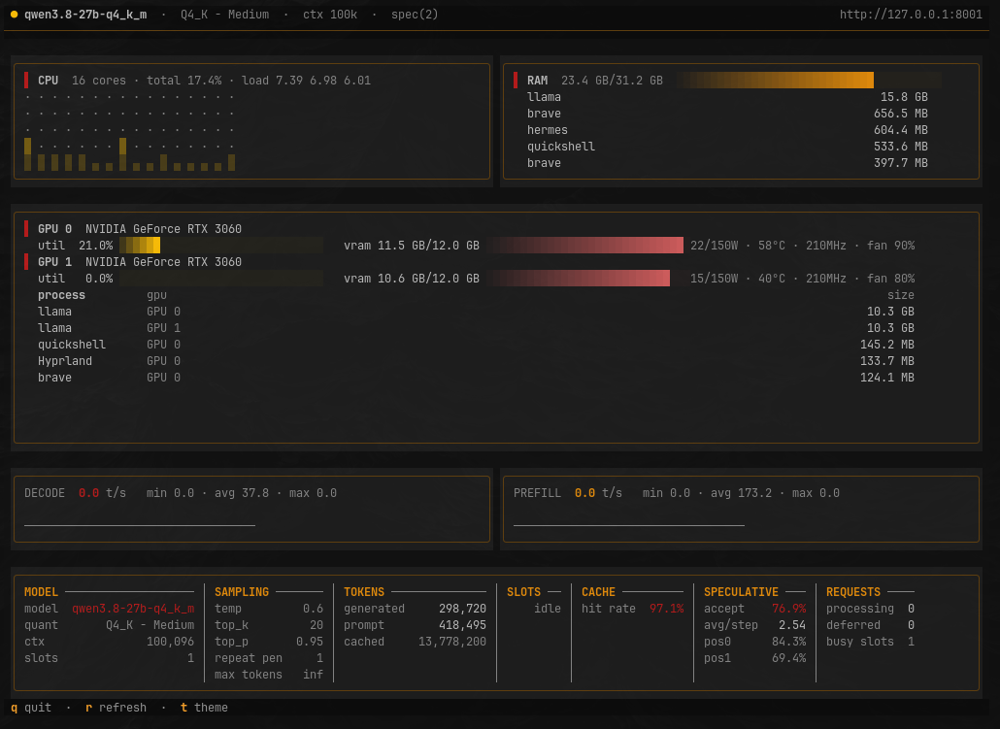
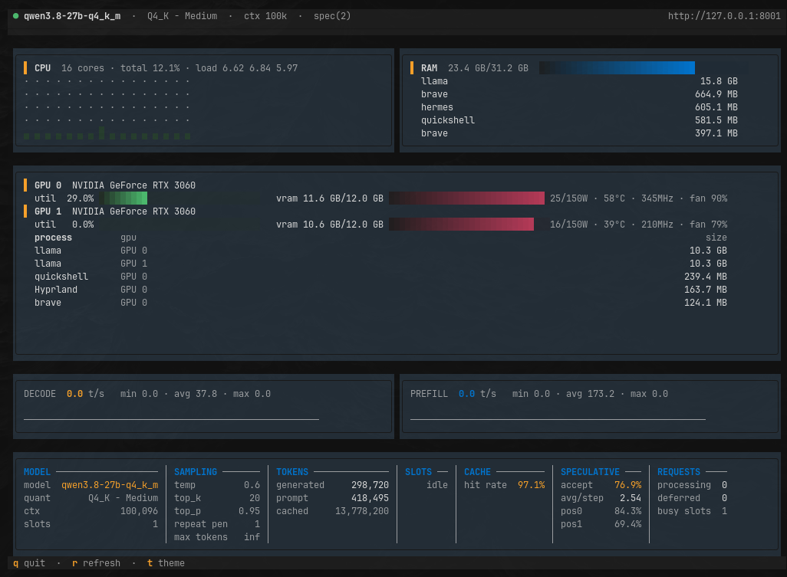
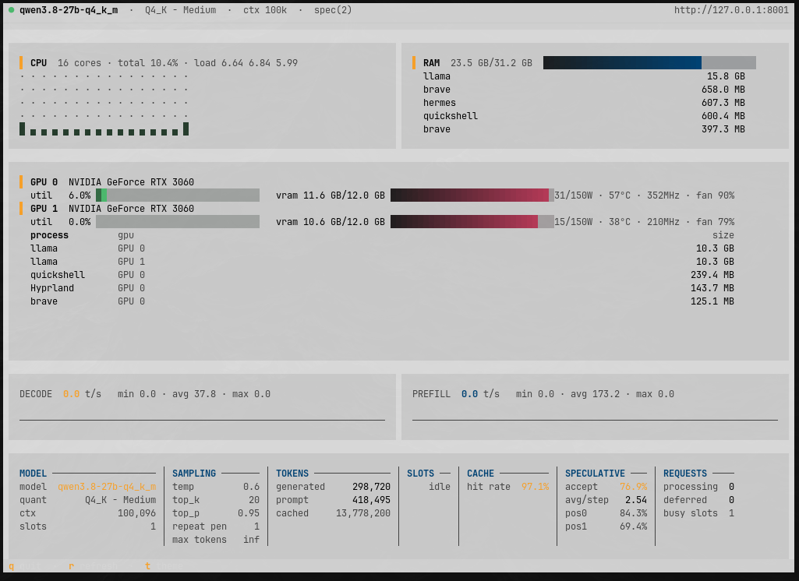
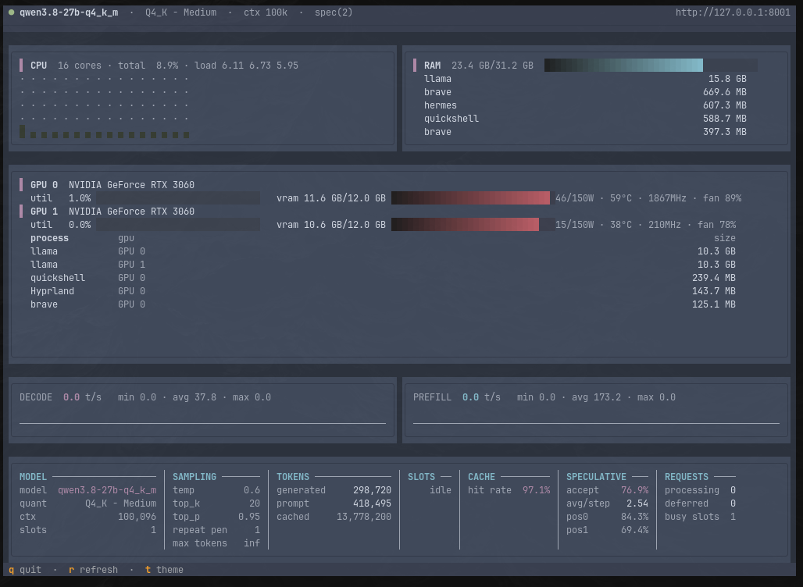
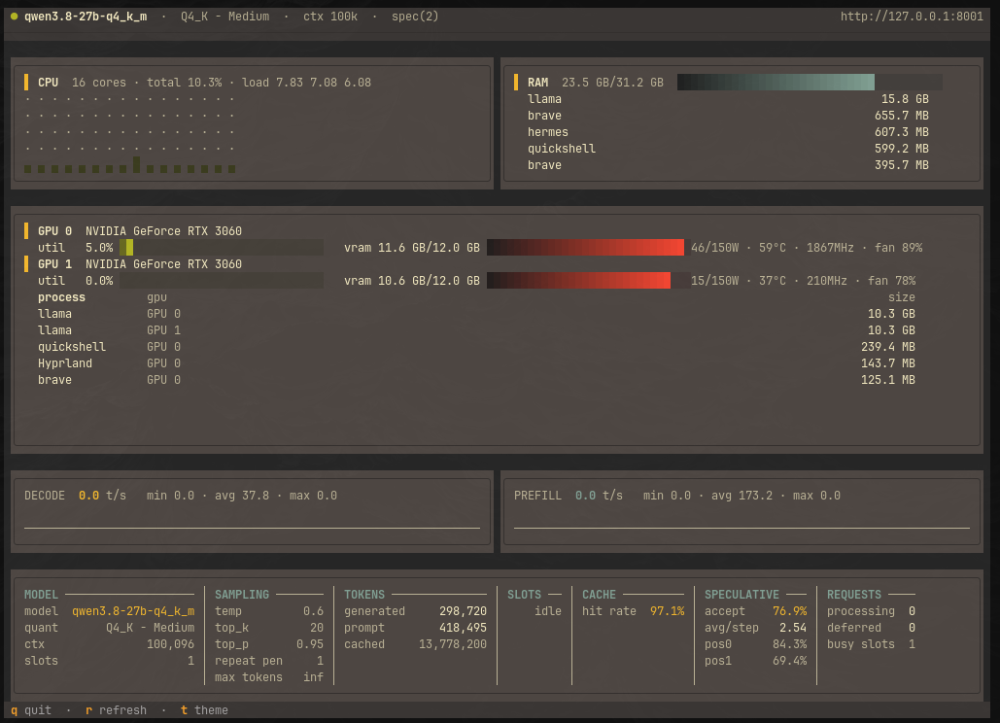
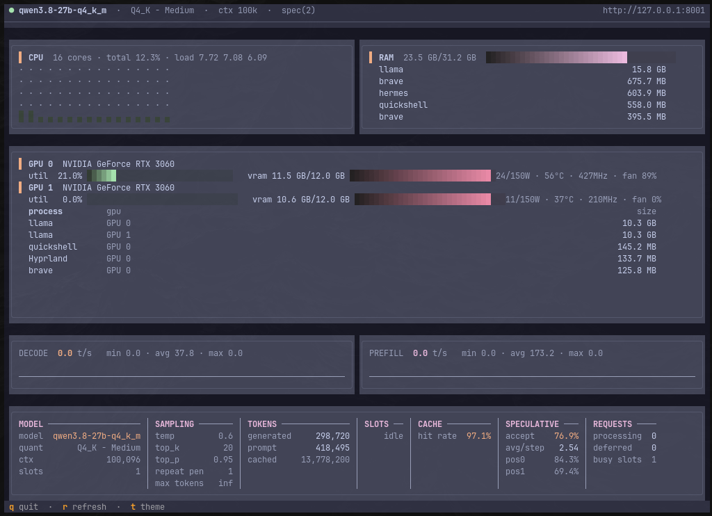
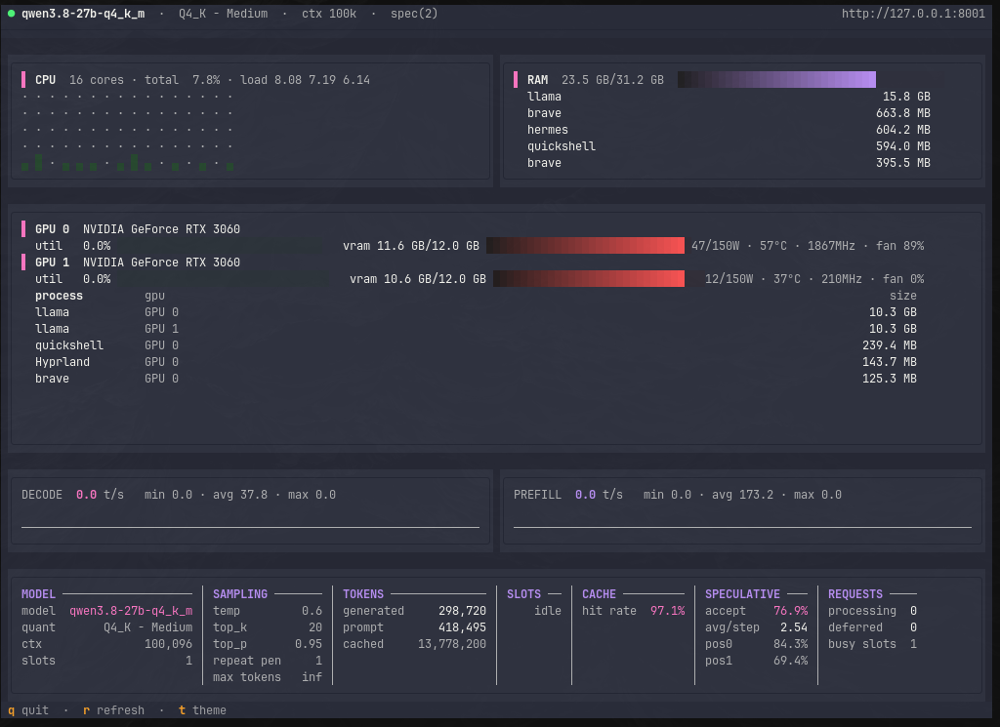
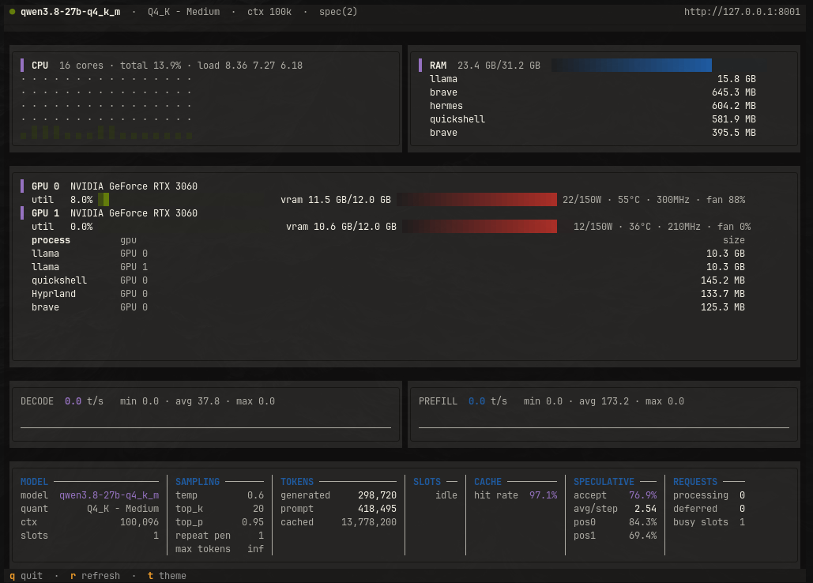
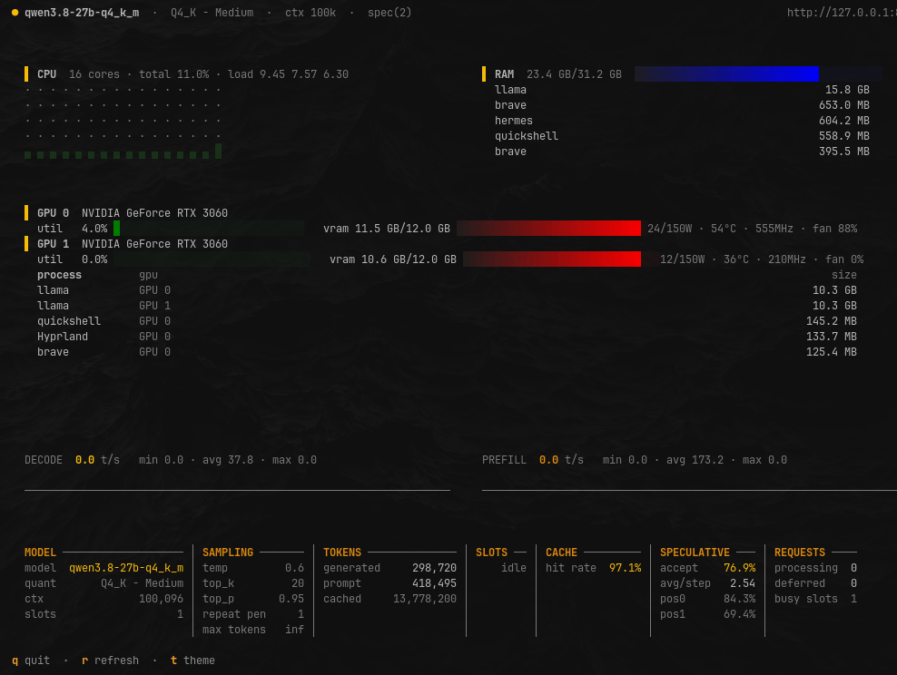
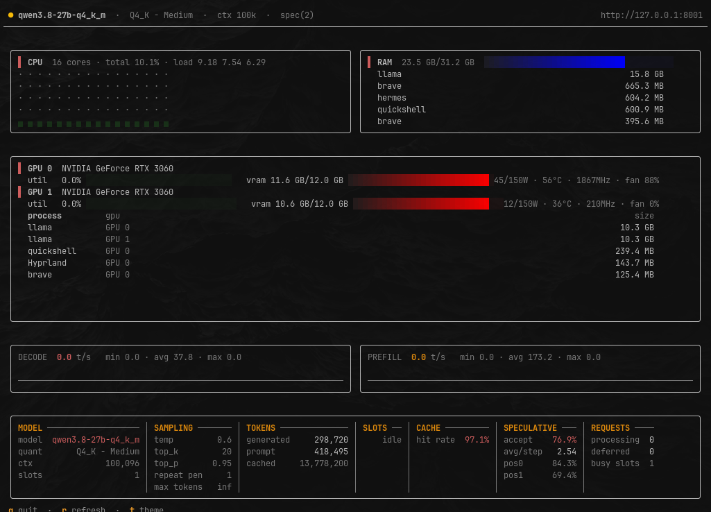

# llm-monitor

**Español** · [English](README.md)

[](https://www.python.org/)
[]()
[]()

Interfaz de terminal (TUI) en tiempo real para monitorear un servidor de
[llama.cpp](https://github.com/ggerganov/llama.cpp) junto con el uso de GPU, CPU y
RAM del equipo.

`llm-monitor` combina tres fuentes de datos en un único dashboard:

- **llama.cpp** — endpoints Prometheus `/metrics`, `/props` y `/slots`.
- **GPU** — a través de [NVML](https://nvidia.github.io/nvidia-ml-py/)
  (`nvidia-ml-py`).
- **CPU y RAM** — leyendo directamente `/proc` del sistema.

Muestra el throughput de tokens (decode / prefill) en gráficos tipo sparkline, los
parámetros del modelo, la decodificación especulativa, el *cache hit rate*, las
peticiones activas y, por encima de todo, el estado de tus GPUs y del equipo.

---

## Showcase

La interfaz se adapta al tamaño de tu terminal y al tema activo. Pulsa `t` para
ciclar entre todos los temas disponibles; el tema de tu máquina
([Omarchy](https://omarchy.com/), si está presente) aparece como **`system`** y
es el primero del ciclo.

| | |
| --- | --- |
|  |  |
| **system** (tema de Omarchy) | **textual-dark** |
|  |  |
| **textual-light** | **nord** |
|  |  |
| **gruvbox** | **catppuccin-mocha** |
|  |  |
| **dracula** | **tokyo-night** |
|  |  |
| **monokai** | **flexoki** |

---

## Características

- **GPU (NVML):** utilización, VRAM usada/total, potencia (con *cap* del driver),
  temperatura, reloj y ventilador, además de la VRAM por proceso.
- **CPU:** uso total, cargas del sistema y rejilla de uso por núcleo
  (desde `/proc/stat`).
- **RAM:** memoria usada/total y procesos por consumo de RSS
  (desde `/proc/meminfo`).
- **llama.cpp:**
  - gráficos de throughput instantáneo de **decode** y **prefill** (t/s), con
    mínimo, media y máximo de la sesión.
  - panel con modelo, cuantización, contexto (`n_ctx`), modalidades, parámetros de
    sampling y build.
  - **slots en vivo:** tareas, tokens restantes, prefill y caché (requiere
    `--slots` en el servidor).
  - **decodificación especulativa:** tasa de aceptación, avg/step y aceptación por
    posición.
  - **cache hit rate** y número de tokens en caché.
  - solicitudes en curso y diferidas.
- **Layout adaptativo:** el dashboard se redimensiona solo para caber en cualquier
  terminal, sin importar su tamaño — incluso al redimensionar la terminal en
  caliente, sin cuadros desfasados.
- **Temas:** adopta el tema activo de [Omarchy](https://omarchy.com/) (si está
  presente) y sigue los cambios en directo; aparece como **`system`** (el
  primero del ciclo de temas) y también acepta temas integrados de Textual o
  personalizados con `--theme`.

---

## Requisitos

| Requisito | Detalle |
| --- | --- |
| **Python** | 3.11 o superior |
| **Sistema** | Linux (usa `/proc`; macOS y Windows aún no están soportados) |
| **GPU (opcional)** | NVIDIA con driver y NVML disponibles (`nvidia-smi` funciona) |
| **Servidor** | `llama-server` con el endpoint `/metrics` habilitado |

> Sin GPU NVIDIA la aplicación funciona igualmente: los paneles de CPU, RAM y
> llama.cpp siguen disponibles y el panel de GPU muestra el error correspondiente.

---

## Instalación

### 1. Clona el repositorio

```bash
git clone https://github.com/treceroot/llm-monitor.git
cd llm-monitor
```

### 2. Instala en un entorno virtual (recomendado)

```bash
python3 -m venv .venv
source .venv/bin/activate

# instalación normal
pip install .

# o instalación editable, si vas a modificar el código
pip install -e ".[dev]"
```

Comprueba que el comando quedó disponible:

```bash
llm-monitor --help
```

### 3. Alternativa: instala como herramienta aislada con pipx

Si solo quieres usar la aplicación y no ensuciar ningún entorno de Python:

```bash
pipx install .
```

### Actualizar

```bash
git pull
pip install --force-reinstall .   # o: pipx reinstall llm-monitor
```

### Desinstalar

```bash
pip uninstall llm-monitor         # o: pipx uninstall llm-monitor
```

### Notas sobre la GPU

- El paquete `nvidia-ml-py` se instala como dependencia; **no** instales también
  `pynvml`, porque ambos exponen el mismo módulo y provocan conflictos.
- Lo normal es que `nvidia-smi` funcione sin privilegios. Si tu distribución
  restringe el acceso a NVML, ejecuta la app como root o añade tu usuario al grupo
  correspondiente (normalmente `video` o `nvidia`).
- En contenedores, la GPU debe estar expuesta al contenedor (`--gpus all` en
  Docker) para que NVML la detecte.

### ¿Problemas con la instalación?

| Síntoma | Causa probable / solución |
| --- | --- |
| `llm-monitor: command not found` | El entorno virtual no está activado o `~/.local/bin` no está en el `PATH` (caso de `pipx`). |
| `ModuleNotFoundError: tomllib` | Estás usando Python 3.10 o anterior; se requiere 3.11+. |
| El panel de GPU muestra un error | Driver NVIDIA ausente, NVML sin permisos o GPU no expuesta al contenedor. |
| `pynvml` lanza un `FutureWarning` | Tienes `pynvml` y `nvidia-ml-py` instalados a la vez: `pip uninstall pynvml`. |

---

## Uso

Arranca el servidor de llama.cpp con las métricas habilitadas:

```bash
llama-server -m modelo.gguf --host 127.0.0.1 --port 8001 --metrics --slots
```

- `--metrics` habilita el endpoint Prometheus `/metrics`.
- `--slots` habilita `/slots`, necesario para el panel de slots en vivo y para los
  gráficos de throughput más precisos.
- El puerto debe coincidir con el que pases a `llm-monitor` mediante `--url`.

Después, lanza el monitor en otra terminal:

```bash
llm-monitor
```

Pulsa `q` para salir.

### Opciones de la línea de comandos

| Opción | Valor por defecto | Descripción |
| --- | --- | --- |
| `--url` | `http://127.0.0.1:8001` | URL base del servidor de llama.cpp. |
| `--interval` | `0.5` | Intervalo de muestreo en segundos. |
| `--theme` | Tema de Omarchy / Textual | Tema de Textual: `textual-dark`, `nord`, `catppuccin-mocha`, `dracula`, … |

```bash
llm-monitor --url http://127.0.0.1:8080 --interval 0.25 --theme nord
```

> **Nota:** la aplicación debe ejecutarse en una **terminal** (modo TUI). No está
> pensada para lanzarse desde un entorno sin TTY, como CI o un servicio systemd sin
> `tty`.

---

## Atajos de teclado

| Tecla | Acción |
| --- | --- |
| `q` | Salir |
| `r` | Refrescar los datos ahora mismo |
| `t` | Cambiar de tema |

La barra inferior de la interfaz también muestra estos atajos en directo.

---

## Cómo funciona

`llm-monitor` se apoya en tres *collectors* independientes, unidos por un conjunto
de *snapshots* compartidos:

```text
collectors/
├── llama.py      # /metrics, /props y /slots del servidor (httpx + Prometheus)
├── hardware.py   # GPU (NVML), CPU y RAM (lectura de /proc)
└── types.py      # dataclasses con los datos compartidos
```

El bucle de polling calcula las tasas instantáneas de tokens (decode y prefill) a
partir de los contadores del servidor, dando prioridad a los datos en vivo de
`/slots` cuando están disponibles. En cada tick se aplica el nuevo *snapshot* a los
paneles y se recalcula el layout adaptativo.

### Requisitos del servidor de llama.cpp

| Endpoint | Flag necesario | Uso en la app |
| --- | --- | --- |
| `/metrics` | `--metrics` | Throughput, caché, peticiones y decodificación especulativa. |
| `/props` | — | Identidad del modelo y parámetros de sampling. |
| `/slots` | `--slots` | Slots en vivo y tasas de tokens más precisas. |

Si `/metrics` no está habilitado, el monitor mostrará el servidor como no
disponible aunque esté funcionando.

---

## Desarrollo

```bash
# instalar en modo editable, si vas a modificar el código
pip install -e ".[dev]"

# lanzar la app en la terminal
llm-monitor
```

### Estructura del proyecto

```text
llm-monitor/
├── src/
│   └── llm_monitor/
│       ├── app.py             # aplicación Textual: layout, polling y keybindings
│       ├── layout.py          # layout adaptativo (presupuesto de filas)
│       ├── theme.py           # resolución de colores y tema Omarchy
│       ├── app.tcss           # estilos CSS/Textual
│       ├── collectors/        # llama.py, hardware.py, types.py
│       └── widgets/           # panels.py, sparkline.py
├── docs/
│   └── showcase/              # capturas de los temas
├── pyproject.toml
├── README.md
└── README.es.md
```

---

## Estado

Versión **0.1.0**.

## Licencia

Todavía no hay una licencia definida en el repositorio. Hasta que se añada una,
todos los derechos quedan reservados. Si quieres publicar el proyecto, añade un
archivo `LICENSE` (por ejemplo, MIT) y declara la licencia en `pyproject.toml`.
