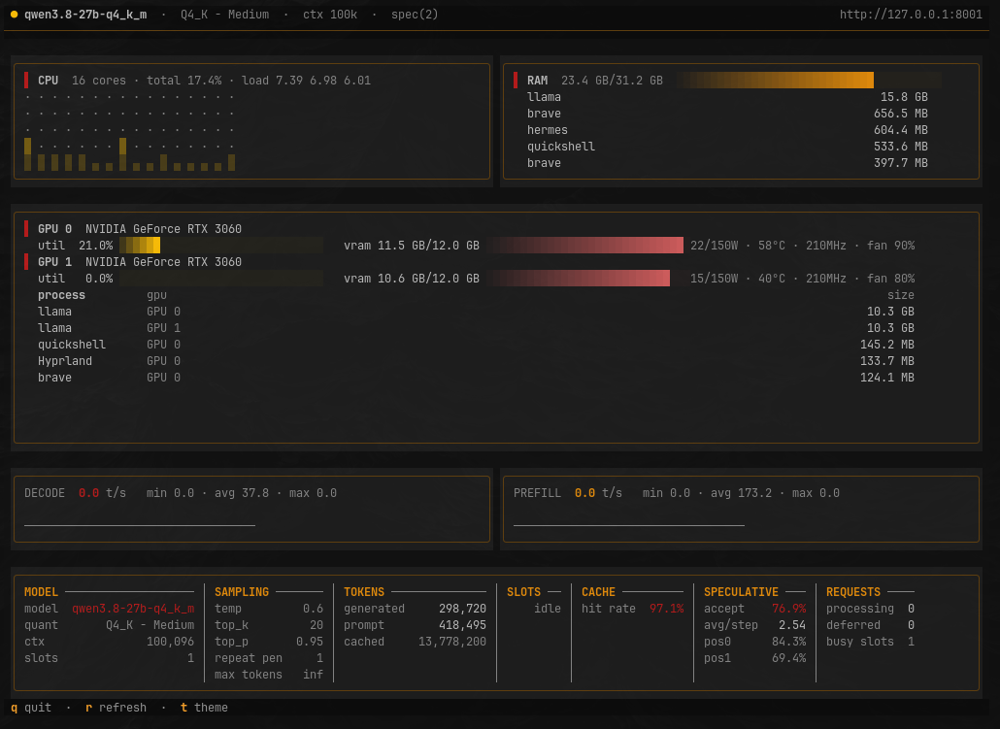
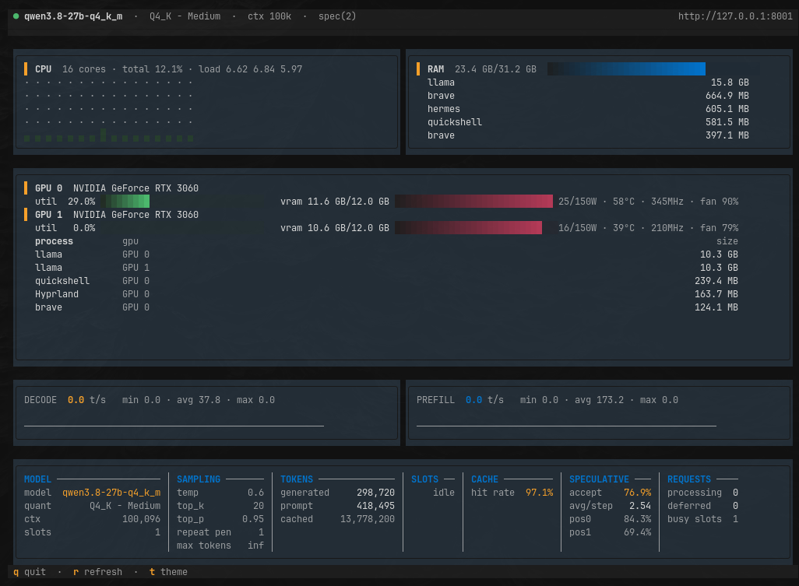
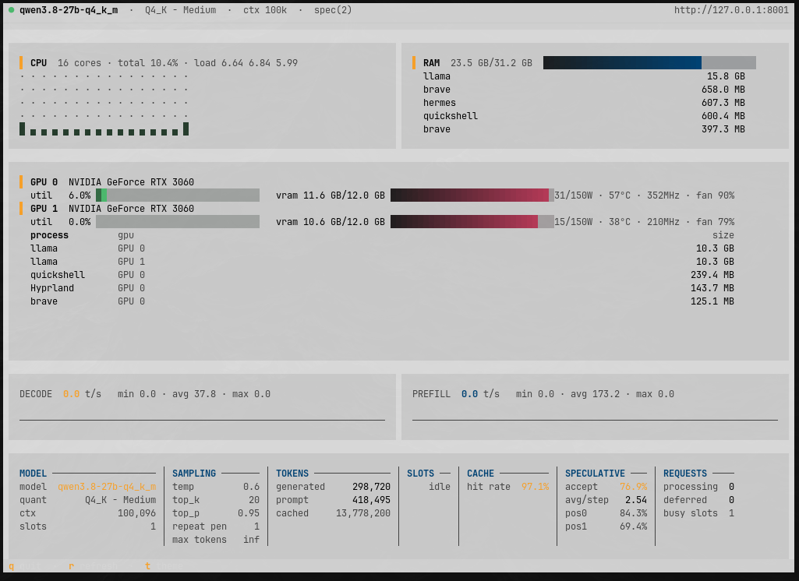
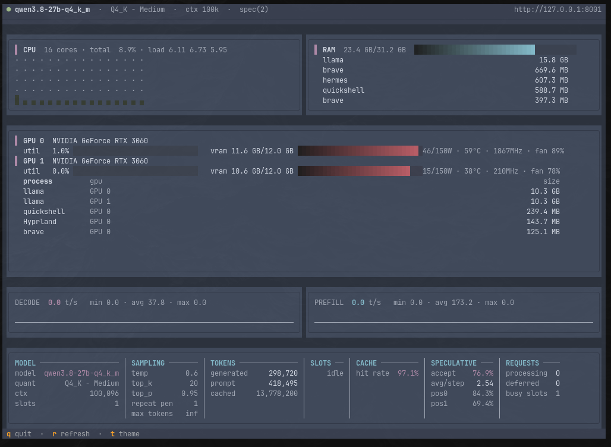
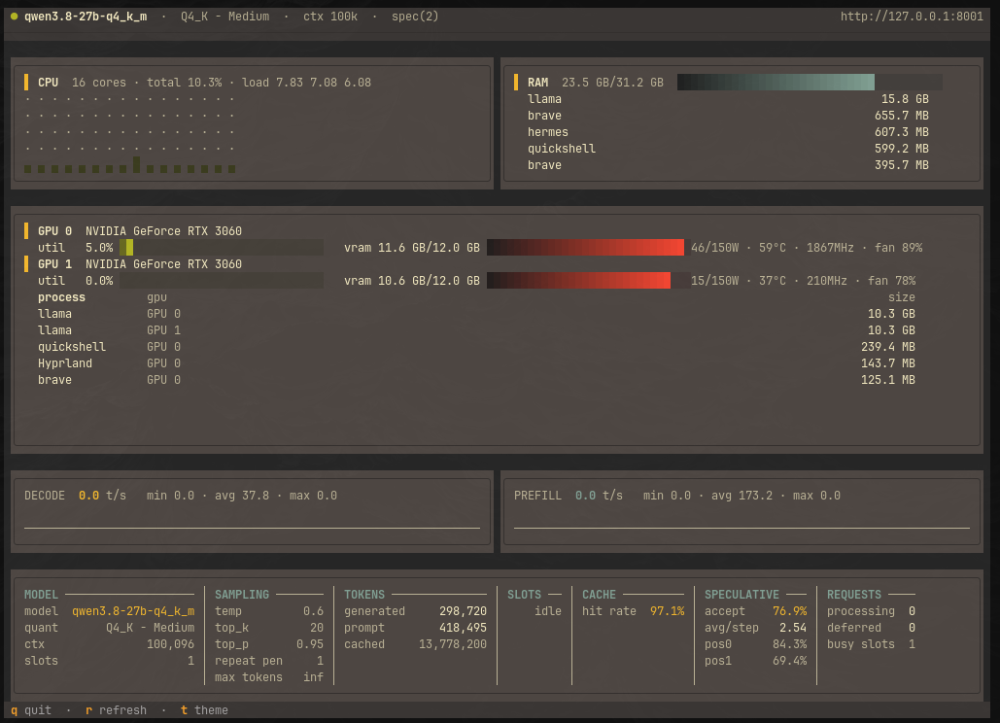
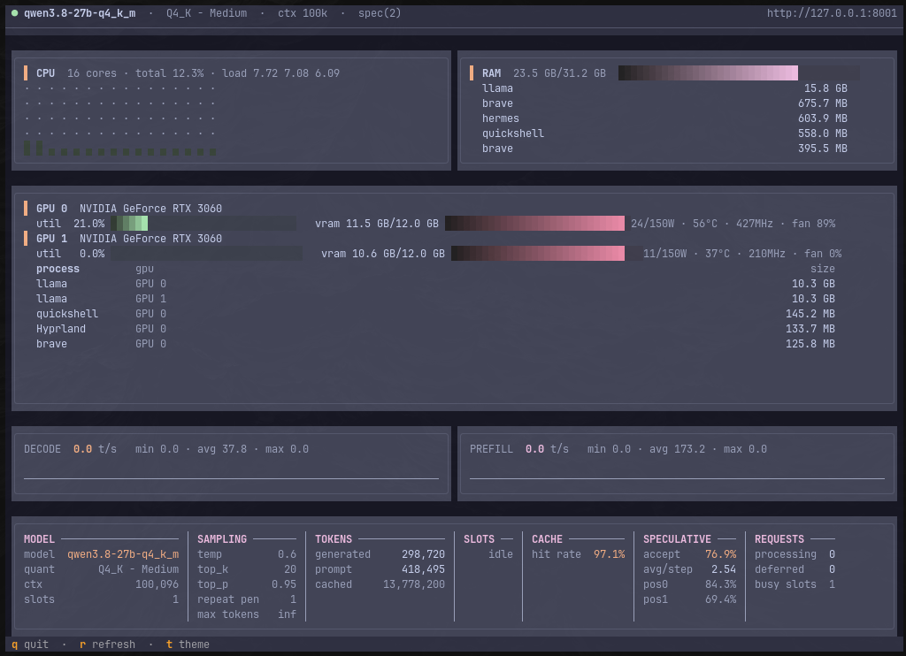
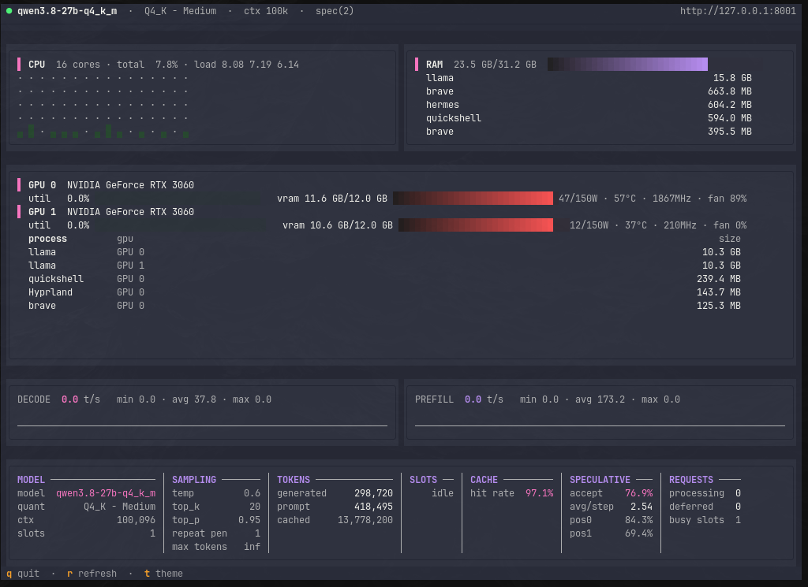
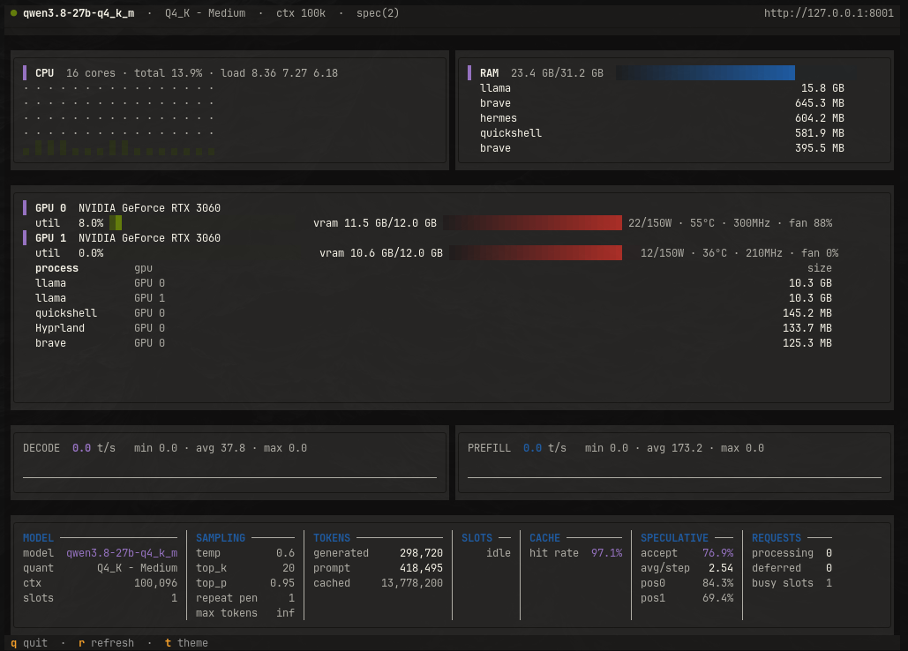
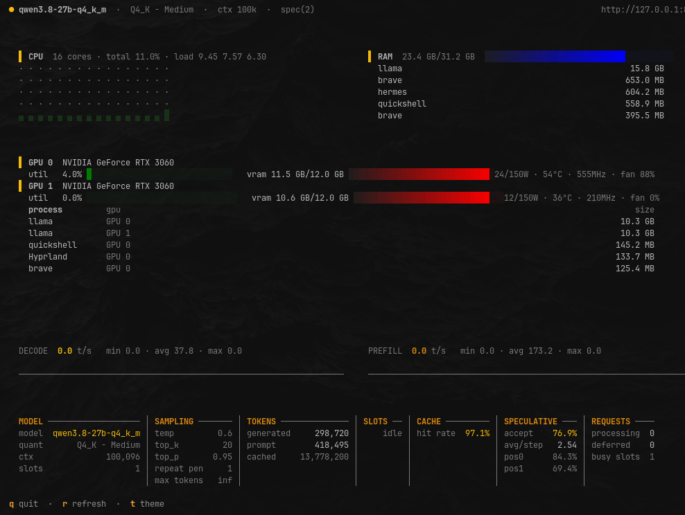
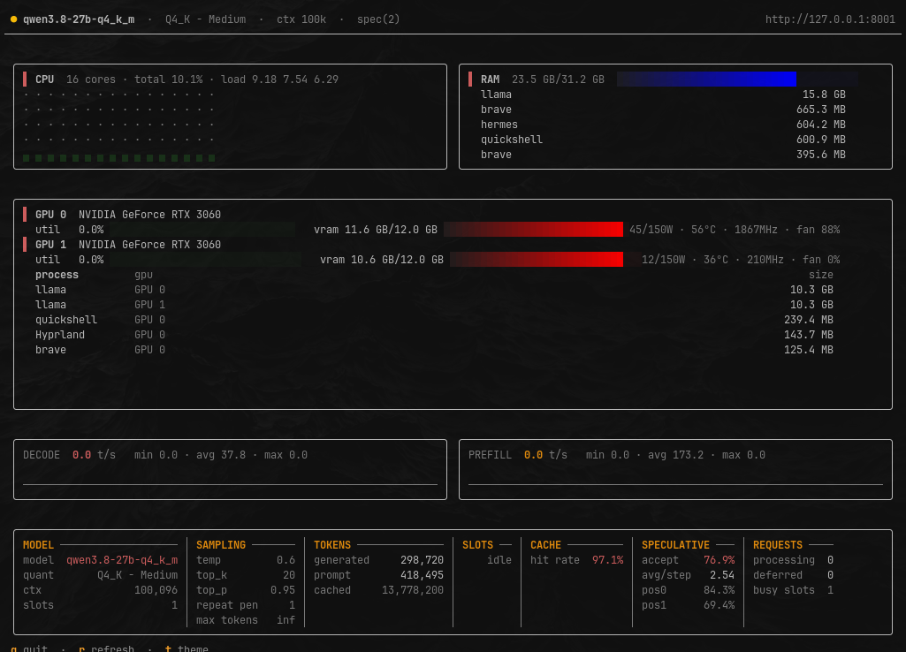

# llm-monitor

**English** · [Español](README.es.md)

[](https://www.python.org/)
[]()
[]()

A real-time terminal UI (TUI) for monitoring a
[llama.cpp](https://github.com/ggerganov/llama.cpp) server alongside the machine's
GPU, CPU and RAM usage.

`llm-monitor` brings three data sources together in a single dashboard:

- **llama.cpp** — Prometheus `/metrics`, plus `/props` and `/slots`.
- **GPU** — through [NVML](https://nvidia.github.io/nvidia-ml-py/)
  (`nvidia-ml-py`).
- **CPU and RAM** — read directly from the system's `/proc`.

It shows token throughput (decode / prefill) as sparkline charts, model parameters,
speculative decoding, cache hit rate and active requests — and above all, the state
of your GPUs and the rest of the machine.

---

## Showcase

The interface adapts to your terminal size and to the active theme. Press `t` to
cycle through all available themes; your machine's theme
([Omarchy](https://omarchy.com/), when present) appears as **`system`** and is the
first one in the cycle.

| | |
| --- | --- |
|  |  |
| **system** (Omarchy theme) | **textual-dark** |
|  |  |
| **textual-light** | **nord** |
|  |  |
| **gruvbox** | **catppuccin-mocha** |
|  |  |
| **dracula** | **tokyo-night** |
|  |  |
| **monokai** | **flexoki** |

---

## Features

- **GPU (NVML):** utilization, VRAM used/total, power (with the driver's *cap*),
  temperature, clock and fan speed, plus per-process VRAM.
- **CPU:** total usage, system load averages and a per-core usage grid
  (from `/proc/stat`).
- **RAM:** used/total memory and processes ranked by RSS (from `/proc/meminfo`).
- **llama.cpp:**
  - instant **decode** and **prefill** throughput charts (t/s), with session min,
    average and max.
  - panel with model, quantization, context (`n_ctx`), modalities, sampling
    parameters and build.
  - **live slots:** tasks, remaining tokens, prefill and cache (requires `--slots`
    on the server).
  - **speculative decoding:** acceptance rate, avg/step and per-position
    acceptance.
  - **cache hit rate** and cached token count.
  - running and deferred requests.
- **Adaptive layout:** the dashboard resizes itself to fit any terminal, no matter
  its size — including live terminal resizes, with no stale frames.
- **Themes:** adopts the active [Omarchy](https://omarchy.com/) theme (when
  present) and follows live changes; it also accepts built-in Textual themes or
  custom ones via `--theme`.

---

## Requirements

| Requirement | Details |
| --- | --- |
| **Python** | 3.11 or newer |
| **OS** | Linux (it reads `/proc`; macOS and Windows are not supported yet) |
| **GPU (optional)** | NVIDIA GPU with the driver and NVML available (`nvidia-smi` works) |
| **Server** | `llama-server` with the `/metrics` endpoint enabled |

> Without an NVIDIA GPU the app still works: the CPU, RAM and llama.cpp panels
> remain available and the GPU panel shows the corresponding error.

---

## Installation

### 1. Clone the repository

```bash
git clone https://github.com/treceroot/llm-monitor.git
cd llm-monitor
```

### 2. Install into a virtual environment (recommended)

```bash
python3 -m venv .venv
source .venv/bin/activate

# regular install
pip install .

# or editable install, if you plan to modify the code
pip install -e ".[dev]"
```

Verify that the command is available:

```bash
llm-monitor --help
```

### 3. Alternative: install as an isolated tool with pipx

If you just want to use the app without touching any Python environment:

```bash
pipx install .
```

### Updating

```bash
git pull
pip install --force-reinstall .   # or: pipx reinstall llm-monitor
```

### Uninstalling

```bash
pip uninstall llm-monitor         # or: pipx uninstall llm-monitor
```

### GPU notes

- `nvidia-ml-py` is installed as a dependency; do **not** also install `pynvml`,
  since both expose the same module and conflict with each other.
- `nvidia-smi` normally works without privileges. If your distribution restricts
  NVML access, run the app as root or add your user to the relevant group (usually
  `video` or `nvidia`).
- In containers, the GPU must be exposed to the container (`--gpus all` in Docker)
  for NVML to see it.

### Installation troubleshooting

| Symptom | Likely cause / fix |
| --- | --- |
| `llm-monitor: command not found` | The virtual environment isn't activated, or `~/.local/bin` isn't on your `PATH` (common with `pipx`). |
| `ModuleNotFoundError: tomllib` | You're on Python 3.10 or older; 3.11+ is required. |
| The GPU panel shows an error | Missing NVIDIA driver, NVML permission issue, or GPU not exposed to the container. |
| `pynvml` raises a `FutureWarning` | Both `pynvml` and `nvidia-ml-py` are installed: `pip uninstall pynvml`. |

---

## Usage

Start the llama.cpp server with metrics enabled:

```bash
llama-server -m model.gguf --host 127.0.0.1 --port 8001 --metrics --slots
```

- `--metrics` enables the Prometheus `/metrics` endpoint.
- `--slots` enables `/slots`, required for the live slots panel and for the most
  accurate throughput charts.
- The port must match the one you pass to `llm-monitor` via `--url`.

Then launch the monitor in another terminal:

```bash
llm-monitor
```

Press `q` to quit.

### Command-line options

| Option | Default | Description |
| --- | --- | --- |
| `--url` | `http://127.0.0.1:8001` | Base URL of the llama.cpp server. |
| `--interval` | `0.5` | Sampling interval in seconds. |
| `--theme` | Omarchy theme / Textual | Textual theme: `textual-dark`, `nord`, `catppuccin-mocha`, `dracula`, … |

```bash
llm-monitor --url http://127.0.0.1:8080 --interval 0.25 --theme nord
```

> **Note:** the app must run in a **terminal** (TUI mode). It is not meant to be
> launched from a TTY-less environment such as CI or a systemd service without
> `tty`.

---

## Keyboard shortcuts

| Key | Action |
| --- | --- |
| `q` | Quit |
| `r` | Refresh data immediately |
| `t` | Cycle through themes |

The bottom bar of the interface also shows these shortcuts live.

---

## How it works

`llm-monitor` relies on three independent *collectors*, joined by a set of shared
*snapshots*:

```text
collectors/
├── llama.py      # server /metrics, /props and /slots (httpx + Prometheus)
├── hardware.py   # GPU (NVML), CPU and RAM (reading /proc)
└── types.py      # dataclasses with the shared data
```

The polling loop computes instant token rates (decode and prefill) from the
server's counters, preferring live `/slots` data when available. On every tick the
new snapshot is applied to the panels and the adaptive layout is recomputed.

### llama.cpp server requirements

| Endpoint | Required flag | Used for |
| --- | --- | --- |
| `/metrics` | `--metrics` | Throughput, cache, requests and speculative decoding. |
| `/props` | — | Model identity and sampling parameters. |
| `/slots` | `--slots` | Live slots and more accurate token rates. |

If `/metrics` is not enabled, the monitor will report the server as unavailable
even if it is running.

---

## Development

```bash
# editable install, if you plan to modify the code
pip install -e ".[dev]"

# launch the app in the terminal
llm-monitor
```

### Project structure

```text
llm-monitor/
├── src/
│   └── llm_monitor/
│       ├── app.py             # Textual app: layout, polling and keybindings
│       ├── layout.py          # adaptive layout (row budget)
│       ├── theme.py           # color resolution and Omarchy theme
│       ├── app.tcss           # CSS/Textual styles
│       ├── collectors/        # llama.py, hardware.py, types.py
│       └── widgets/           # panels.py, sparkline.py
├── docs/
│   └── showcase/              # theme screenshots
├── pyproject.toml
├── README.md
└── README.es.md
```

---

## Status

Version **0.1.0**.

## License

No license has been defined for this repository yet. Until one is added, all rights
are reserved. If you plan to publish the project, add a `LICENSE` file (for
example, MIT) and declare the license in `pyproject.toml`.
